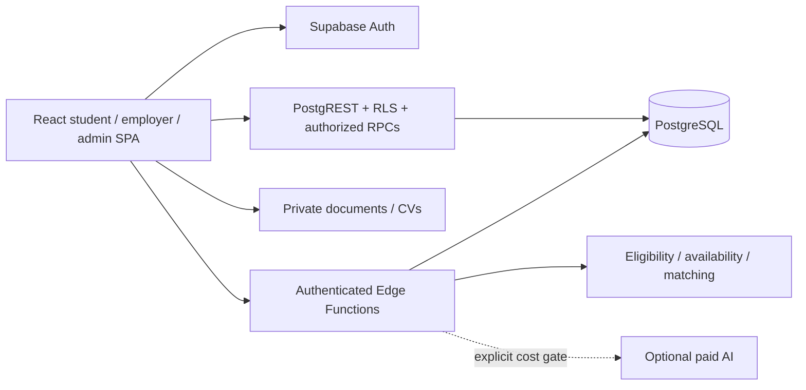

# Architecture

React Router lazy-loads routes. TanStack Query owns server data and clears across account changes/logout. AuthContext reads trusted user_roles/profiles and role-specific records. Editable Auth metadata can suggest a first public account intent/name, never administrative privilege. SQL and Edge Functions recheck authorization.

The database keeps canonical roles `worker`, `business`, `admin`; worker is presented as student/graduate. Private student_profiles hold academic/work preferences and consent declarations. Availability preferences represent willingness to work; private academic_calendar_events represent busy instants. Calendar connection rows contain sync status, never provider credentials. New fixed/flexible job metadata separates concrete shifts from longer employment date ranges.

Sensitive operations use transactional RPCs: first account setup; verification request/document/final review; application submit/state transitions; calendar import/disconnect; quotas and outreach. RLS remains defense in depth. Private CVs use object paths and short-lived signed URLs. Admin hostname configuration changes routing only, not privileges.

## Schedules

`supabase/functions/_shared/availability.ts` is the pure browser/Edge engine, re-exported by `src/lib/availability.ts`. SQL enforces corresponding rules on submission. Preferred-window unions, timezone conversion, minimum length and busy/travel subtraction are deterministic. Nonexistent DST local times fail rather than normalize silently.

`src/lib/calendar.ts` uses pinned ICAL.js for bounded recurrence/exclusion/override expansion and private busy intervals. It also creates explicit stable-UID calendar downloads. ICS is a 120-day snapshot, not a live connection. Read-only connection metadata supplies the coverage boundary to browser, Edge and SQL checks; a shift plus travel outside it cannot be confirmed. Provider adapters are isolated HTTP integrations; a future OAuth boundary must bind one-time state/PKCE to the signed-in owner and encrypt/revoke backend tokens. Browser localStorage must never hold calendar refresh tokens.

## Agents

Request authentication, trusted roles, input caps and atomic quotas precede all expensive work. Baseline matching/templates are deterministic, explainable and truthful. Scores cannot override eligibility or timetable constraints. Approval is default; automatic and external submissions are gated. Candidate outreach is a real in-app notification, not an assumed delivered email.

## Verification boundaries

Vitest tests pure rules, React forms/auth and embedded PostgreSQL migration/RLS execution with substitute Auth/Storage schemas. Playwright drives the real SPA with isolated HTTP fixtures on desktop/mobile. Deno checks server types. Full Supabase Auth/PostgREST/Storage/OAuth staging remains a separate requirement.

## Future programmes

Future programme/cohort/mentor/learning-outcome tables should reference marketplace users without overloading hiring statuses or widening calendar access. Institution roles need separate policies. No corporate/university programme is activated.
